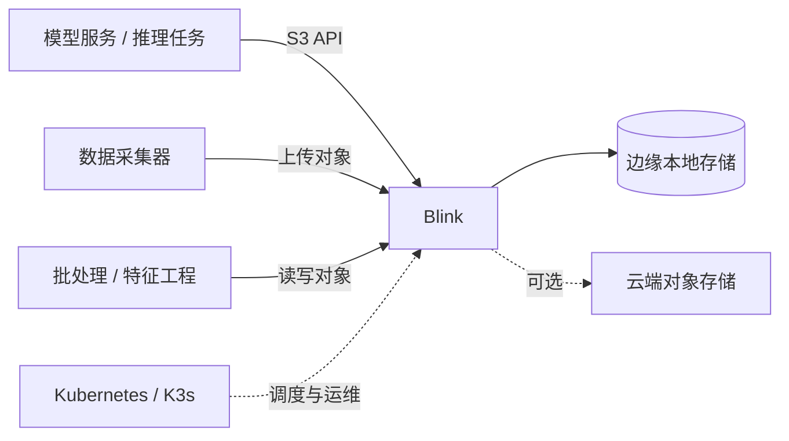

# Blink

**AI Native Cloud S3：面向 Kubernetes、K3s 和边缘推理场景的轻量、高性能对象存储。**

[](./LICENSE)
[](#项目状态)

Blink 用 S3 兼容的对象存储接口，为边端 AI 推理提供模型、特征、数据集、输入输出和中间结果的统一数据平面。它面向资源受限、网络不稳定、需要快速启动的边缘环境设计，可以部署在 Kubernetes 或 K3s 集群中，也可以作为单节点服务运行。

## 为什么是 Blink

边缘推理通常同时面对几个问题：模型文件体积大、节点存储和内存有限、推理服务需要低延迟读取、多个工作负载需要共享数据，而中心云存储又可能受到网络带宽和连接稳定性的限制。

Blink 的目标是把对象存储能力放到推理任务附近：

- **靠近计算**：部署在边缘节点或边缘集群，减少跨地域网络访问。
- **兼容 S3**：使用成熟的 S3 工具链和 SDK，降低应用接入成本。
- **面向 AI 数据路径优化**：重点优化模型加载、大对象顺序读写、分片上传和推理结果落盘。
- **云原生部署**：适配 Kubernetes、K3s、容器和单节点部署方式。
- **轻量易运维**：适合资源有限、无人值守或网络间歇连接的边缘环境。

## 典型场景

- 在工厂、园区、矿山、门店等边缘节点分发和加载推理模型。
- 保存摄像头、传感器和工业设备产生的原始数据或抽样数据。
- 为多个推理服务共享模型权重、Tokenizer、配置和特征文件。
- 写入推理结果、告警、向量、日志和需要异步回传的数据。
- 在云边协同架构中缓存云端下发的数据，并在网络恢复后同步结果。

## 目标架构



Blink 的数据访问边界是标准对象存储接口。上层应用通过 Bucket 和 Object 组织数据，底层负责本地持久化、并发访问、容量管理以及后续的云边同步能力。

## 设计目标

| 方向 | 目标 |
| --- | --- |
| 访问接口 | 提供常用 S3 API，支持主流 S3 SDK 和命令行工具接入 |
| 性能 | 针对模型加载和大对象读写降低访问延迟，提高边缘节点吞吐 |
| 部署 | 支持 K3s、标准 Kubernetes、Docker 和单节点部署 |
| 资源占用 | 适配 CPU、内存、磁盘和网络资源有限的边缘设备 |
| 可靠性 | 支持服务重启后的数据恢复，并逐步完善校验、监控和故障处理 |
| 可运维性 | 提供健康检查、指标、日志和 Kubernetes 原生配置 |

## 项目状态

项目目前处于**早期开发阶段**。当前仓库已建立项目基础和开源许可证，服务实现、容器镜像、Helm Chart 以及完整的 S3 API 兼容性仍在建设中。性能数据和生产环境建议将在可重复的基准测试完成后发布。

在首个可运行版本发布前，README 中的部署命令、配置项和 API 支持范围不会被视为稳定接口。欢迎通过 Issue 讨论使用场景、接口优先级和边缘部署需求。

## 规划中的能力

- S3 兼容的 Bucket、Object、分片上传和范围读取。
- 面向模型文件的大对象顺序读、并发读和快速启动优化。
- 本地磁盘持久化、容量水位控制和数据完整性校验。
- Kubernetes Deployment/StatefulSet、Service、PVC 和探针配置。
- K3s 轻量部署，以及单节点开发模式。
- Prometheus 指标、结构化日志和健康检查。
- 云边数据同步、缓存预热和断网续传。
- 多租户访问控制、TLS、密钥管理和审计能力。

## 快速开始

当前版本尚未发布可执行二进制或容器镜像。待首个可运行版本发布后，快速开始流程将包含以下步骤：

1. 获取 Blink 镜像或二进制。
2. 创建本地数据目录或 Kubernetes PersistentVolumeClaim。
3. 配置监听地址、数据目录、访问密钥和存储容量策略。
4. 启动服务并通过健康检查确认实例状态。
5. 使用 AWS CLI、MinIO Client 或任意兼容 S3 的 SDK 创建 Bucket 并读写对象。

预期的客户端访问方式如下，具体端点和凭据配置以实际发布版本为准：

```bash
# 以 AWS CLI 为例
aws --endpoint-url http://<blink-endpoint> s3 mb s3://models
aws --endpoint-url http://<blink-endpoint> s3 cp model.bin s3://models/model.bin
aws --endpoint-url http://<blink-endpoint> s3 cp s3://models/model.bin ./model.bin
```

## Kubernetes / K3s 部署

Blink 的推荐生产形态是运行在带持久化卷的 Kubernetes 或 K3s 工作负载中。部署时建议：

- 为数据目录绑定本地盘、Local PersistentVolume 或其他低延迟持久化存储。
- 为 Blink 设置明确的 CPU、内存和临时存储资源限制。
- 使用 `readinessProbe` 和 `livenessProbe` 接入集群调度与故障恢复。
- 通过 Secret 管理 S3 访问密钥，通过 Service 暴露集群内访问端点。
- 根据模型大小和并发推理量规划磁盘吞吐、网络带宽和副本拓扑。

示意部署关系如下：

```text
推理 Pod ──> Blink Service ──> Blink Pod ──> PVC / 本地磁盘
                                      └──> 可选的云端对象存储
```

正式 Kubernetes 清单和 Helm Chart 会在服务接口稳定后加入仓库，并提供适用于 K3s 单节点和多节点集群的示例配置。

## 性能验证

Blink 将围绕以下指标建立可复现的基准测试：

- 首字节延迟（TTFB）和完整对象读取延迟。
- 模型文件顺序读取吞吐和并发读取吞吐。
- 单对象上传、分片上传和批量小对象写入性能。
- CPU、内存、磁盘 I/O 和网络开销。
- 服务重启、磁盘水位变化和网络抖动下的数据可用性。

在正式基准结果发布前，请不要将“极快”理解为固定的性能承诺；实际结果会受到磁盘类型、网络、对象大小、并发数和 Kubernetes 节点配置影响。

## 开发计划

- [ ] 完成核心对象存储服务和本地持久化层
- [ ] 提供基础 S3 API 和 SDK 互操作测试
- [ ] 发布 Docker 镜像和本地开发启动方式
- [ ] 提供 Kubernetes 与 K3s 部署清单
- [ ] 增加健康检查、指标和基准测试
- [ ] 完善认证、授权、TLS 和审计
- [ ] 实现云边同步、缓存预热和断网续传
- [ ] 发布首个稳定版本和兼容性文档

## 参与贡献

欢迎提交 Issue、改进建议和 Pull Request。提交代码前，请先通过 Issue 描述问题或设计意图，便于讨论 API、数据格式和兼容性影响。

建议的贡献内容包括：

- 边缘设备和 K3s 的部署反馈。
- S3 SDK、AWS CLI 或 MinIO Client 的兼容性测试。
- 模型加载和大对象读写的性能数据。
- 存储可靠性、可观测性和云边同步方面的设计建议。

## 许可证

Blink 采用 [Apache License 2.0](./LICENSE) 开源。使用、修改和分发本项目请遵守许可证条款。

## 联系方式

- GitHub Issues：<https://github.com/binbinpeng123/Blink/issues>
- 项目仓库：<https://github.com/binbinpeng123/Blink>
